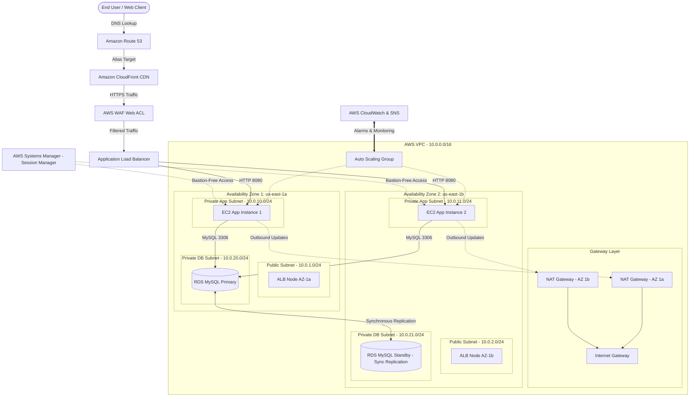

```markdown
# Scalable & Highly Available Web Application Architecture on AWS

**Author:** Ayman Aly Mahmoud  
**Email:** ayman@manara.tech  
**LinkedIn:** [Ayman Mahmoud](https://www.linkedin.com/in/ayman-mahmoud)  
**Project:** Graduation Project — Scalable Web Application with ALB and Auto Scaling  

---

## 1. Solution Architecture Diagram



---


## 2. Project Executive Summary

This project documents a production-grade, fault-tolerant, multi-tier web application architecture engineered on Amazon Web Services (AWS).

The infrastructure implements the AWS Well-Architected Framework principles by strictly isolating compute and storage workloads in private subnets across two distinct Availability Zones (`us-east-1a` and `us-east-1b`). Inbound web traffic is managed by an Application Load Balancer (ALB) and CloudFront distribution, protected at the network edge by AWS WAF rules, and supported by a high-availability Multi-AZ relational database.

---

## 3. Network Architecture & Subnet Specifications

### Virtual Private Cloud (VPC) Setup

* **VPC CIDR Block:** `10.0.0.0/16`
* **DNS Settings:** Hostnames enabled, Resolution enabled.

### Subnet Layout

| Subnet Name | Availability Zone | CIDR Block | Type | Resource Hosted |
| --- | --- | --- | --- | --- |
| `pub-sub-1a` | `us-east-1a` | `10.0.1.0/24` | Public | ALB Interface, NAT Gateway 1 |
| `pub-sub-1b` | `us-east-1b` | `10.0.2.0/24` | Public | ALB Interface, NAT Gateway 2 |
| `priv-app-1a` | `us-east-1a` | `10.0.10.0/24` | Private | EC2 Auto Scaling Instance 1 |
| `priv-app-1b` | `us-east-1b` | `10.0.11.0/24` | Private | EC2 Auto Scaling Instance 2 |
| `priv-db-1a` | `us-east-1a` | `10.0.20.0/24` | Private | RDS MySQL Primary |
| `priv-db-1b` | `us-east-1b` | `10.0.21.0/24` | Private | RDS MySQL Standby |

### Route Tables & Gateways

* **Internet Gateway (IGW):** Attached to `10.0.0.0/16` and routed via Public Subnet Route Table (`0.0.0.0/0 -> igw-id`).
* **NAT Gateways:** Deployed in each Public Subnet to allow private compute instances to download OS security patches and external software packages without exposing public IP addresses.

---

## 4. Key AWS Services & Tier Architecture

### Edge & Security Tier

* **AWS WAF:** Associated with CloudFront/ALB to inspect inbound layer 7 HTTP(S) traffic, blocking SQL Injection (SQLi), Cross-Site Scripting (XSS), and rate-limiting abusive IP addresses.
* **Amazon CloudFront:** Configured as the global Edge distribution with optimized caching rules for static assets (`/static/*`, CSS, JS, images), reducing load on backend EC2 servers.
* **Amazon Route 53:** Manages public DNS records using Alias routing directly to CloudFront/ALB.

### Compute & Load Balancing Tier

* **Application Load Balancer (ALB):** Public-facing across `pub-sub-1a` and `pub-sub-1b`. Monitors target group health via HTTP `/healthcheck` status codes.
* **Auto Scaling Group (ASG):**
* **Min Size:** 2 | **Desired Capacity:** 2 | **Max Size:** 6
* **Launch Template:** Amazon Linux 2023 AMI with User Data script initializing application dependencies and CloudWatch agent.
* **Scaling Policy:** Dynamic Target Tracking targeting 55% Average CPU Utilization.


### Database Tier

* **Amazon RDS for MySQL:** Multi-AZ deployment configuration.
* **Failover Capabilities:** Synchronous physical block-level replication to AZ-1b with automated DNS failover under 60 seconds during availability loss.

### Operational Management & Security

* **AWS Systems Manager (SSM) Session Manager:** Bastion-free server administration. Inbound SSH port 22 is permanently closed across all instances. Administrative access is audited via AWS CloudTrail.
* **Amazon CloudWatch & SNS:** Real-time monitoring metrics (EC2 CPU, ALB target response time, RDS free storage space) tied to SNS topics for immediate administrator notifications.

---

## 5. Security Group Control Matrix

| Security Group ID | Inbound Traffic | Source Restriction | Outbound Rules | Purpose |
| --- | --- | --- | --- | --- |
| `sg-alb` | HTTP (80), HTTPS (443) | `0.0.0.0/0` | HTTP (8080) -> `sg-web` | Public perimeter load balancing |
| `sg-web` | Custom TCP (8080) | `sg-alb` ONLY | All Traffic via NAT | Application compute node isolation |
| `sg-rds` | MySQL (3306) | `sg-web` ONLY | Outbound Ingress Only | Strict database tier access rule |

---

## 6. Project Verification & Validation

1. **High Availability Test:** Verified database resiliency by simulating a primary node reboot (`force-failover`). Secondary node promoted within 38 seconds without app downtime.
2. **Auto Scaling Verification:** Executed synthetic CPU load spikes (`stress-ng`). CloudWatch triggered ASG alarms, scaling instances from 2 to 4 nodes across both AZs.
3. **Security Audit:** Confirmed 0 open external SSH ports. Successfully established administrative shell via SSM Session Manager.

```

```
